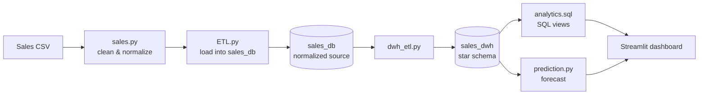

<div align="center">

# 🚀 SalesFlow

### Sales Analytics & Data Engineering

**Transforming Raw Sales Data into Business Insights**

<p>
  
  
  
  
</p>

<p>
  <b>ETL</b> · <b>Data Warehousing</b> · <b>SQL Analytics</b> · <b>Sales Prediction</b>
</p>

</div>

---

## 📌 Overview

**SalesFlow** is a data engineering and analytics project that transforms raw sales data into structured datasets for business analysis and reporting.

It combines Python, Pandas, PostgreSQL, PySpark, and Streamlit to demonstrate data processing, database integration, analytical SQL, and interactive data visualization. The goal is a practical workflow that connects data preparation, storage, analytics, and prediction in one project.

## ✨ Key Features

| Feature | Description |
|---|---|
| 🔄 ETL Pipeline | Load, clean, and transform sales data. |
| 🗄️ PostgreSQL Integration | Store and manage structured data in a relational database. |
| 🏛️ Data Warehouse | Star schema designed for analytical workloads. |
| 📊 SQL Analytics | SQL views that support sales analysis. |
| 📈 Interactive Dashboard | Explore sales insights through Streamlit. |
| 🤖 Prediction Workflow | PySpark validation model and a 3-year revenue/profit forecast. |

## 🛠️ Technology Stack

- **Python**: core programming language
- **Pandas / NumPy**: data manipulation and numerical work
- **PostgreSQL**: relational database
- **SQLAlchemy / psycopg2**: database connectivity
- **PySpark**: prediction workflow
- **Streamlit / Plotly / Matplotlib**: dashboard and charts
- **SQL**: schema definition and analytical views
- **Git & GitHub**: version control and hosting

## 🖥️ Dashboard Pages

| Page | What it shows |
|---|---|
| Business overview & KPIs | Revenue, profit, orders, margin |
| Time trends | Monthly, quarterly, and yearly performance |
| Categories & products | Category, subcategory, product, and manufacturer breakdowns |
| Segments & regions | Customer segment and regional performance |
| Discount impact | Discount levels vs. profitability |
| Sales predictions | 3-year revenue and profit forecast, top products, CSV download |

## 🏗️ Project Structure

```text
SalesFlow/
├── src/
│   ├── ETL.py
│   ├── analysis.py
│   ├── config.py
│   ├── dashboard.py
│   ├── dwh_etl.py
│   ├── prediction.py
│   ├── sales.py
│   └── visuals.py
├── sql/
│   ├── analytics.sql
│   └── dwh_schema.sql
├── data/
│   └── Sales_data (1).csv
├── docs/
│   └── images/
├── .env.example
├── .gitignore
├── requirements.txt
└── README.md
```

## 🔄 Data Flow



## 🧭 Architecture & Data Model

**Source database (`sales_db`)** is normalized: `customers`, `manufacturers`, `categories`, `subcategories`, `products`, `locations`, `orders`, `order_items`.

**Data warehouse (`sales_dwh`)** is a star schema:

- **Fact table:** `fact_sales` (one row per order item): discount, quantity, sales, profit
- **Dimensions:** `dim_date`, `dim_customer`, `dim_product`, `dim_location`
- `fact_sales` references `dim_date` twice (order date and ship date)

<details>
<summary><b>📂 View Data Source Overview</b></summary>


</details>

<details>
<summary><b>🗃️ View Sales Schema</b></summary>


</details>

<details>
<summary><b>🏛️ View Data Warehouse Schema</b></summary>


</details>

## 🚀 Getting Started

### Prerequisites

- Python 3.11
- PostgreSQL
- Java (a JDK supported by Spark 3.5, e.g. 11 or 17), required by PySpark
- Git

### 1. Clone the Repository

```bash
git clone <YOUR_REPOSITORY_URL>
cd SalesFlow
```

### 2. Create a Virtual Environment

```bash
python -m venv .venv
source .venv/bin/activate      # Linux / WSL
# .venv\Scripts\activate       # Windows
```

### 3. Install Dependencies

```bash
python -m pip install -r requirements.txt
```

### 4. Configure Environment Variables

```bash
cp .env.example .env
```

Then edit `.env` with your own values.

| Variable | Description | Example |
|---|---|---|
| `DB_HOST` | PostgreSQL host | `localhost` |
| `DB_PORT` | PostgreSQL port | `5432` |
| `DB_USER` | Database user | `postgres` |
| `DB_PASSWORD` | Database password (never commit) | `change_me` |
| `SOURCE_DB_NAME` | Source database name | `sales_db` |
| `DWH_DB_NAME` | Data warehouse database name | `sales_dwh` |

**Never commit `.env` or expose real database credentials.**

### 5. Prepare the Databases

Create two empty PostgreSQL databases matching `SOURCE_DB_NAME` and `DWH_DB_NAME`.

### 6. Run the Pipeline

Run all commands from the **project root**, in this order:

```bash
python src/ETL.py          # load the source data into sales_db
python src/dwh_etl.py      # build the star schema in sales_dwh
python src/analysis.py     # create the analytics views
python src/prediction.py   # generate the forecast (needs Java)
```

> ⚠️ `dwh_etl.py` clears the warehouse tables before reloading them. Use a dedicated development database, and never run it on data you cannot recreate.

### 7. Launch the Dashboard

```bash
python -m streamlit run src/dashboard.py
```

Open the local URL shown in the terminal (usually `http://localhost:8501`).

## 🔮 Sales Forecast: Method & Limitations

`prediction.py` has two parts:

1. **Validation model:** a PySpark Gradient-Boosted Trees regressor predicts line-item sales. Metrics (RMSE, MAE, R²) are saved to `prediction_outputs/metrics.json`. It checks how well the model learns the data and is **not** shown in the dashboard.
2. **Multi-year forecast (shown in the dashboard):** monthly totals are fitted with a linear trend plus month-of-year seasonality (least squares) and projected 3 years ahead.

Limitations:

- Product-level numbers are an **allocation** of the forecast total, based on each product's share over the last 12 months. They are not independent per-product forecasts.
- Predicted profit = predicted sales × the product's recent margin, so products with a negative recent margin stay negative.
- The forecast has not been backtested yet.

## 📁 Dataset & Attribution

The project uses a sales dataset published on Kaggle:

**Source:** [Sales Dataset — Kaggle](https://www.kaggle.com/datasets/raghavkhandelwal65/sales-dataset)

Refer to the original dataset page for its license and attribution requirements.

## 🔒 Configuration & Security

- Credentials are supplied through environment variables only.
- Local `.env` files are excluded from version control.
- `.env.example` is the template for required configuration.
- Review database scripts before running them against important data.

## ⚠️ Known Limitations

- Dimension tables include `effective_date`, `end_date`, and `is_current`, but the ETL loads a full snapshot, so history tracking (SCD Type 2) is not implemented yet.
- ETL reload safety (transactions and idempotency) is still on the roadmap.
- Automated tests are not implemented yet.

## 🧰 Troubleshooting

| Problem | Likely cause |
|---|---|
| `ModuleNotFoundError: No module named 'src'` | Run commands from the project root; inside `src/` use `from config import ...` |
| Connection refused | PostgreSQL is not running, or wrong `DB_HOST` / `DB_PORT` |
| `password authentication failed` | Wrong `DB_PASSWORD` in `.env` |
| PySpark fails to start | Java is not installed or `JAVA_HOME` is not set |
| Forecast page is empty | `python src/prediction.py` has not been run |

## 🗺️ Roadmap

- [ ] Add automated tests for data transformations.
- [ ] Make the ETL idempotent and transactional.
- [ ] Add data quality checks.
- [ ] Backtest the forecast with suitable metrics.
- [ ] Implement SCD Type 2 for customer and product dimensions.
- [ ] Add CI (linting and tests) with GitHub Actions.
- [ ] Add Docker Compose for one-command setup.

## 📌 Project Status

The dashboard runs locally. The ETL, data warehouse, analytics, and prediction workflows should be validated independently before considering the project production-ready.

## 👨‍💻 Author

**Yousef Ibrahem** — Data Analytics Engineer

- GitHub: <your-github-link>
- LinkedIn: <your-linkedin-link>
- Email: <your-email>

---

<div align="center">

**SalesFlow — From Data to Decisions.**

</div>
